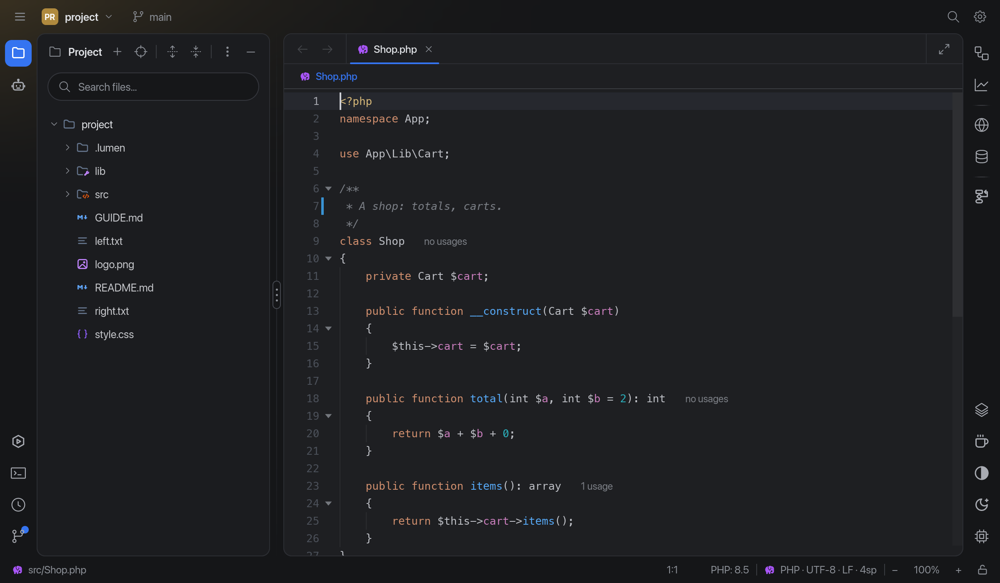
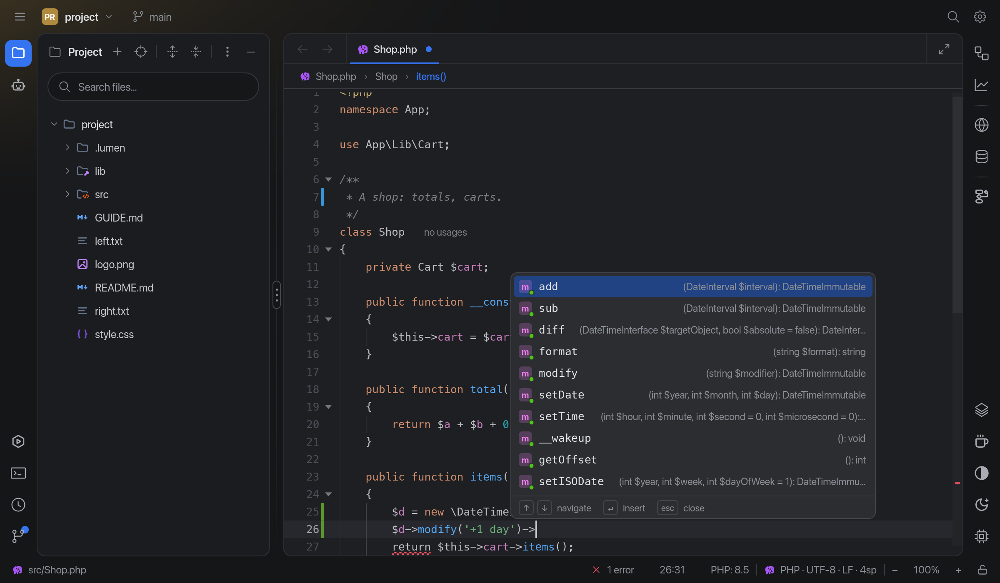
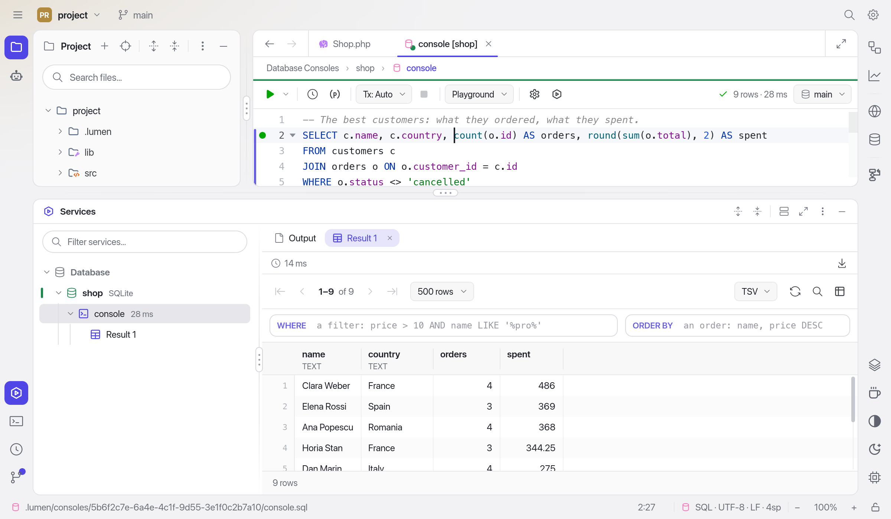
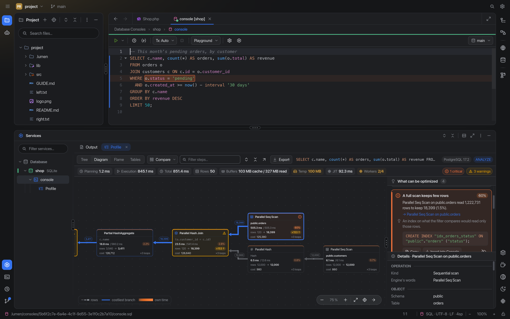
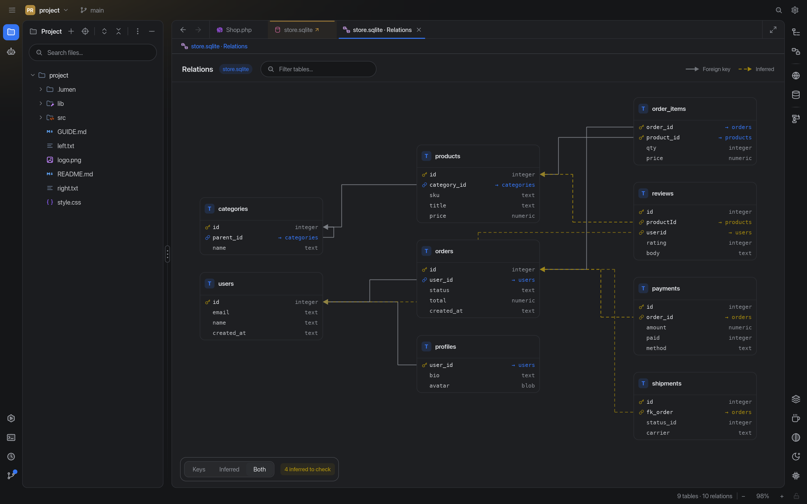
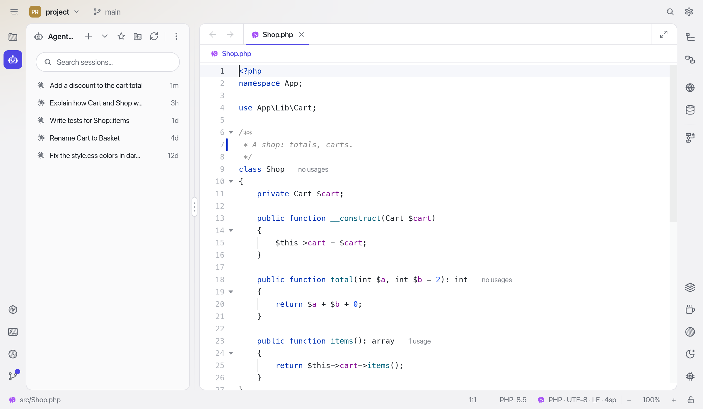
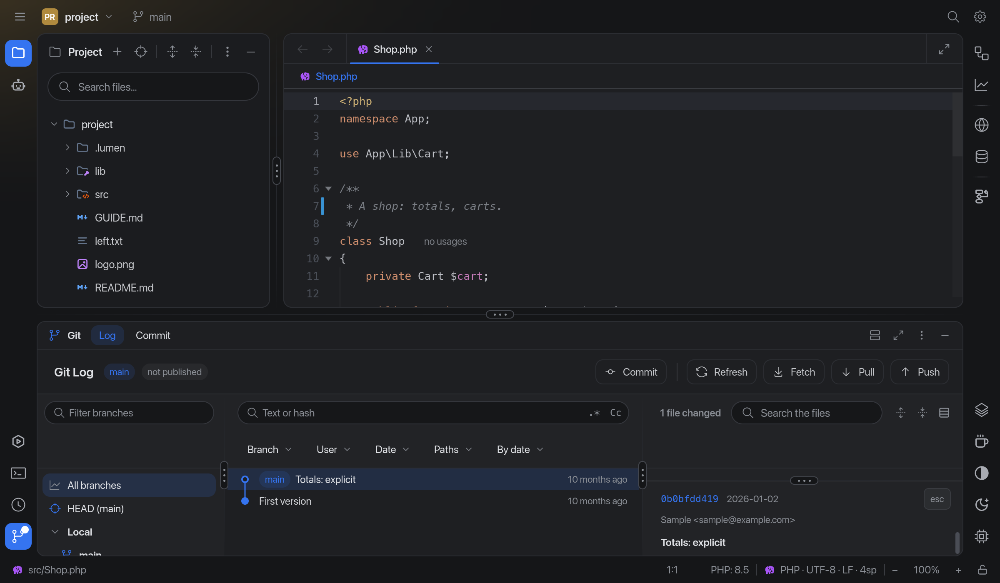
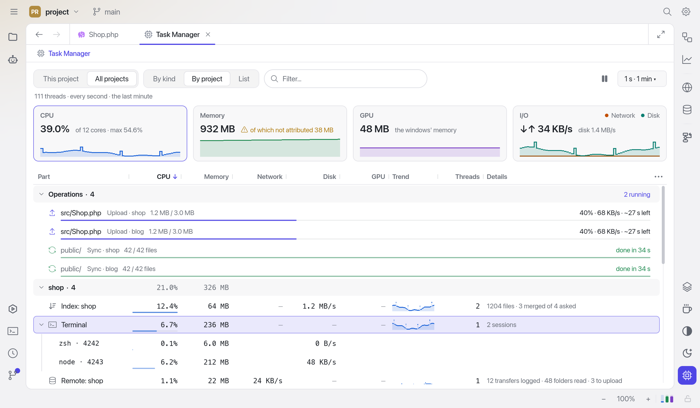
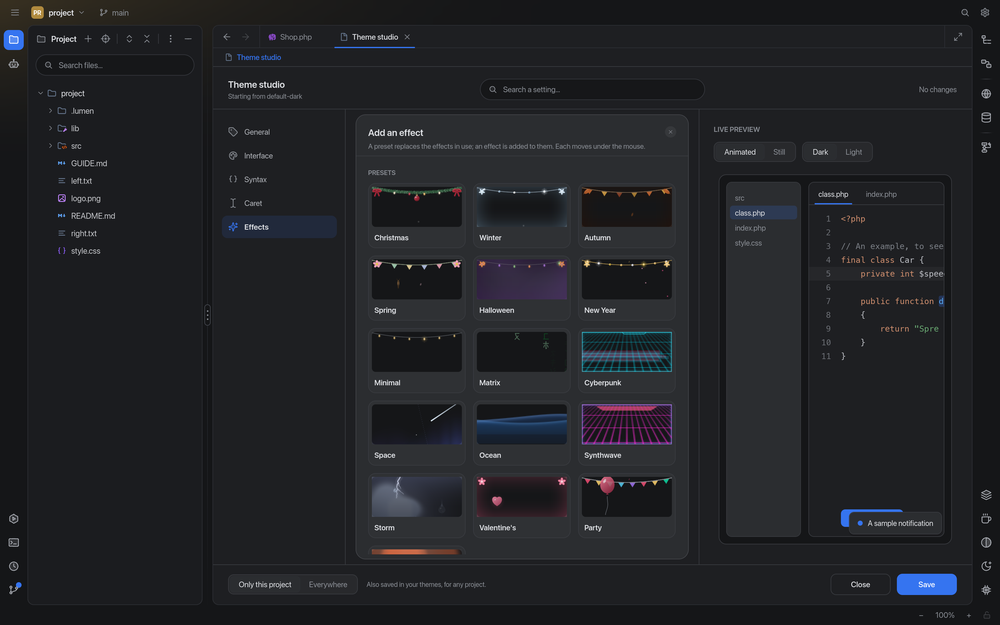

<div align="center">


# Lumen

**A fast, native code editor for many languages, written in Rust.**

GPU-rendered, built from small modules, light on memory, made for macOS, Windows and Linux.

[](https://github.com/binary-cube/lumen-ide/actions/workflows/ci.yml)
[](https://github.com/binary-cube/lumen-ide/releases)


[](LICENSE)

<picture>
  <source media="(prefers-color-scheme: light)" srcset="docs/screenshots/editor-light.png">
  
</picture>

</div>

> [!NOTE]
> **Built with AI, and still being built.** Lumen is written with AI coding agents
> (Claude Code), guided, reviewed and tested by a human: every change goes through the
> same gate of formatting, Clippy on two platforms, the tests and the architecture's rules.
> It is under active development: things change often, some features are unfinished,
> and the releases are betas.

## Why

Full IDEs are heavy (a JVM, gigabytes of RAM, a slow start); light editors are fast but
shallow. Lumen tries to be both: the depth of a full IDE (intelligence, refactoring,
databases, Git, HTTP) for PHP, the web and the other languages you work in, with the
start-up time and memory of a native app.

- **Native and GPU-rendered.** Rust, `wgpu` (Metal, DirectX 12, Vulkan), its own text
  layout and UI. No web view for the interface, no runtime to start.
- **Nothing heavy on the UI thread.** Disk, Git, network, processes and parsing run on
  workers; the window only draws and answers. Frames are drawn only when something changed.
- **Exists only while used.** Every feature is a module, loaded the first time it's
  needed and released when it's not. A closed panel holds nothing.
- **Measured.** Memory, CPU and GPU have budgets, and the app has its own Task Manager
  to show where they go.

## Features

### Code

- **Many languages**: PHP, JavaScript / TypeScript, HTML, CSS / SCSS, SQL, C / C++, Zig,
  Lua, Bash, JSON, YAML, TOML, Markdown, Dockerfile, Blade, Twig, `.env`, `.http` —
  each one highlighted and folded, most with a language server behind it.
- **Intelligence of its own** where it matters most: for PHP, completion with type
  inference, go to definition, usages, implementations and hierarchy, signatures, inlay
  hints and diagnostics (its data generated by reflection from every PHP version); for
  CSS, HTML and JavaScript, completion and docs from MDN's data.
- **Language servers for the rest**: TypeScript, Intelephense / Phpactor, clangd, zls,
  lua-language-server, taplo, Bash, Dockerfile, YAML, CSS, HTML and more, downloaded on
  first use and run per project.
- **Refactoring**: rename, move, change signature, with a preview of every change.
- **Frameworks**: Symfony, Laravel, Yii, React, Vue, htmx.



### Databases

- **SQL consoles** for SQLite, PostgreSQL and MySQL / MariaDB, with completion from the
  schema, parameters, transactions, history and a grid you can edit, filter and export.
- **Query profiles**: the plan as a tree, a diagram or a flame graph, with what can be
  optimized and the index that would help.
- **Relations**: the tables and their keys as a diagram, foreign keys inferred where
  they're missing.



<table>
  <tr>
    <td></td>
    <td></td>
  </tr>
</table>

### AI agents

- **Agent Sessions**, on the left beside the project: every session of the project's agents
  (Claude Code, Cline), the most recent first, searched, starred, renamed; a new one
  started, or one taken up again, in a terminal tab of the editor.
- **An MCP server** (off until turned on): the agents on your machine use the editor —
  the files open, the selection, a file's text — through tools the modules offer
  ([docs](docs/mcp-server.md)).



### And around the code

- **Git**: log and branches, commit, diff and merge, blame, a file's history.
- **HTTP client**: `.http` files (the common request-file format) with environments,
  scripts and a visual editor.
- **Terminal** in tabs or at the bottom, each project with its own command history.
- **Remote projects** over SFTP / FTP, **local history**, **diagrams** (draw.io files and
  class diagrams), **Markdown**, image and CSV viewers, a compare and merge view.
- **Task Manager**: what each part of the app and each program it started costs, live.
- **Themes and a theme studio**, with seasonal decorations and animated effects.

<table>
  <tr>
    <td></td>
    <td></td>
  </tr>
  <tr>
    <td colspan="2"></td>
  </tr>
</table>

## Installing

Download the file for your system from the
[releases](https://github.com/binary-cube/lumen-ide/releases) (the newest one at the top).
Once installed, Lumen updates itself: it tells you when a new version is out, and
installs it when you choose to.

### macOS (Apple Silicon)

1. Download `lumen-<version>-macos-arm64.zip` and open it: **Lumen.app** appears.
2. Drag **Lumen.app** into your **Applications** folder.
3. Open it. The first time, macOS says it *could not verify "Lumen.app"* (it isn't
   notarized by Apple yet). Click **Done**, then:
   1. open **System Settings › Privacy & Security**;
   2. scroll down to *"Lumen.app" was blocked to protect your Mac* and click **Open Anyway**;
   3. confirm with your password or Touch ID, and click **Open**.

   Or, instead of these three steps, in **Terminal**:

   ```sh
   xattr -dr com.apple.quarantine /Applications/Lumen.app
   ```

This is asked only once: the app's own updates don't ask again. When you open a project
in *Documents*, *Desktop* or *Downloads*, macOS asks whether Lumen may read that folder:
click **Allow**.

Intel Macs have no build of their own: Lumen builds on them from source (below).

### Windows (x64)

- **The installer**, `lumen-<version>-windows-x64-setup.exe`: run it. It installs Lumen
  for you only (no administrator), adds it to the Start menu, and to *Settings › Apps*
  to remove it.
- **Or the program alone**, `lumen-<version>-windows-x64.zip`: unzip it anywhere and run
  `lumen.exe`.

The first time, SmartScreen may say *Windows protected your PC* (the builds aren't
signed yet): click **More info**, then **Run anyway**.

### Linux (x86_64)

Download `lumen-<version>-linux-x86_64.tar.gz`, extract it, and run `./lumen`.

### Checking a download

Each release lists its files' SHA-256 in `SHA256SUMS`; `latest.json`, what the app's
updates read, is signed with the project's key (`packaging/release-key.pub`).

## Building from source

**You need** [Rust](https://rustup.rs) 1.99 or newer. Nothing else: no PHP, no Node,
no Docker (language servers that need Node bring their own).

```sh
git clone git@github.com:binary-cube/lumen-ide.git
cd lumen-ide
cargo run --release -p app            # runs the editor
cargo run --release -p app -- path/   # opens a folder as a project
```

Packaged builds (a macOS `.app`, a Windows `.exe`, a Linux archive) come from
`scripts/build.sh` (`scripts/build.ps1` on Windows); they land in `dist/`. A local build
uses thin LTO on every core; `--full` builds what releases ship (fat LTO, slower to build).

## How it's built

```
crates/
  kernel/      the base everything shares: ids, caches, work queues, the brand
  domain/      pure models and rules, no I/O (documents, PHP, SQL, Git, HTTP…)
  infra/       what the domain's ports need: files, processes, language servers, drivers
  render/      the renderer (wgpu, and a software fallback), text, icons
  platform/    windows and input (winit)
  ui/          the design system and the shared components
  modules/     every feature, one module each (languages, database, git, tools…)
  app/         the composition root: wires the rest together
```

- **Domain-driven layers**, declared in `architecture.toml` and checked by
  `cargo xtask check-deps`.
- **Modules never know each other.** They meet through contributions, the project's
  events, small requests and the host, never a direct dependency; a test removes each in
  turn and checks nothing else breaks.
- **Plans first.** Each feature starts as a plan in `docs/plan/` (in Romanian), with what
  was done and what was left once it's built.

The working rules for humans and agents are in [`CLAUDE.md`](CLAUDE.md) and
[`.claude/rules/`](.claude/rules/project-conventions.md).

## Contributing

Issues and ideas are welcome. Before a pull request, run the same gate the project uses:

```sh
./scripts/check.sh   # rustfmt, Clippy for the host and Windows, the tests, check-deps
```

## Roadmap

What's planned next is in [ROADMAP.md](ROADMAP.md).

## Code signing policy

Free code signing on Windows provided by [SignPath.io](https://about.signpath.io),
certificate by [SignPath Foundation](https://signpath.org) (applied for: until it's
granted, the Windows builds are unsigned).

- **Committers and reviewers:** the members of [Binary Cube](https://github.com/orgs/binary-cube/people).
- **Approvers:** the owners of [Binary Cube](https://github.com/orgs/binary-cube/people).

Every release is built from this repository by GitHub Actions on GitHub's own machines
(`.github/workflows/release.yml`) and its signing approved by hand. The macOS builds are
signed with the project's own certificate; each release's files are listed with their
SHA-256 in `SHA256SUMS`, and `latest.json` is signed with the project's key.

## Privacy

Lumen collects nothing about you and sends no telemetry (the language servers' own is
turned off). It connects only to:

- **GitHub**, to look for a new version (now and then, or when you ask; turned off in
  Settings › Updates) and to download it when you choose to;
- **the language servers' and tools' sources** (npm, Node.js, GitHub releases), pinned
  and checked, the first time a file needs one;
- **what you connect it to yourself**: your databases, remote projects (SFTP / FTP), the
  requests of your `.http` files, the AI agents you start.

The MCP server, off until you turn it on, listens only on your own machine.

## License

Lumen is under the [MIT license](LICENSE).

The parts of other projects it carries keep their own licenses: the syntax grammars in
[`third_party`](third_party), each in its folder with its license file, and the language
servers it can download, listed with theirs in [`packaging/lsp/NOTICE`](packaging/lsp/NOTICE).
