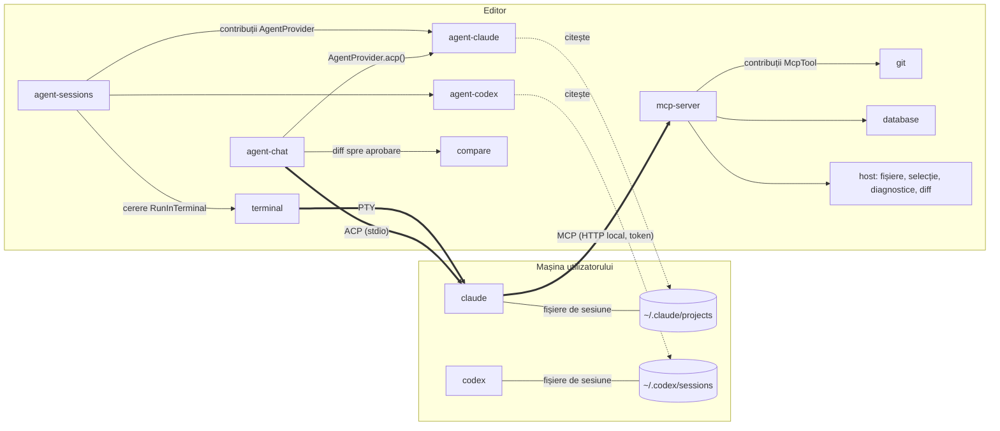
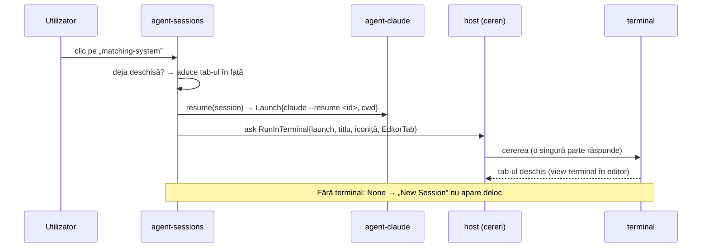
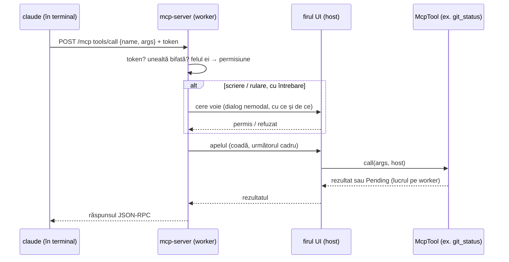
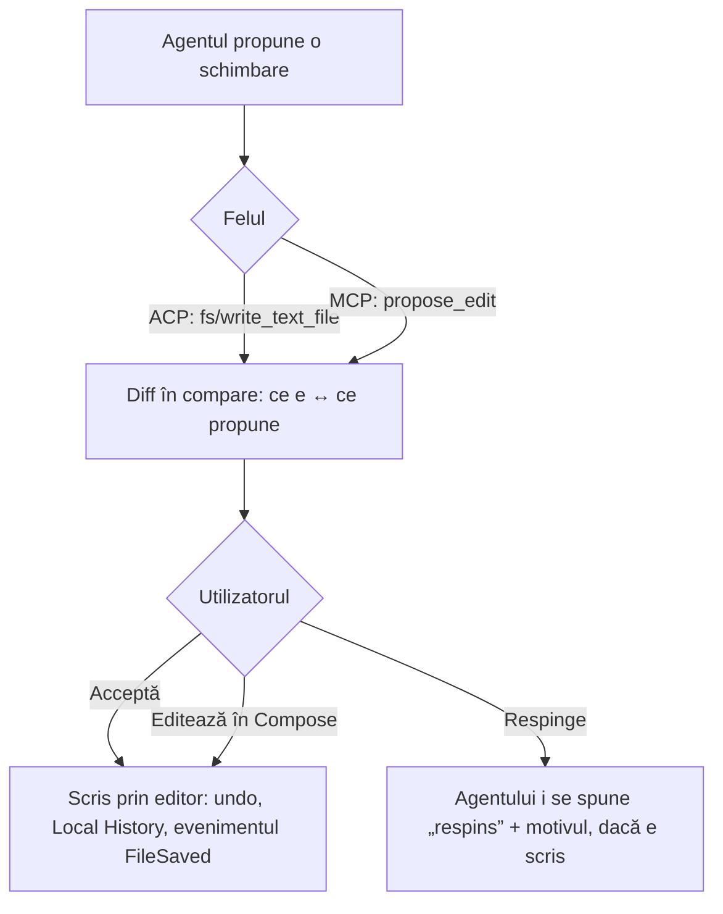

# 79 — Agenți AI: sesiunile lor, o interfață grafică, serverul MCP al editorului

**Stare (2026-11-15): aprobat; deciziile utilizatorului în „Decizii”. Nimic început.
Fazele 79a → 79g, în ordine, fiecare cu commit-ul ei, pe branch-ul `agents`.**

Cerut 2026-11-15 (capturile din conversație: un IDE cu agenți integrați, panoul „Agent Sessions”,
popover-ul „MCP Server”):

- o listă a **sesiunilor de agent** deschise pe mașină (Claude Code, Codex, Gemini…).
  O sesiune se deschide tot ca **terminal**, dar ca tab al editorului, cu iconița
  agentului în locul celei de fișier;
- **„New Session” cu agentul ales** (lista agenților găsiți pe mașină, „Manage Agents…”);
- comunicarea cu agentul să meargă și **printr-o interfață grafică**, nu doar prin CLI;
- **editorul să expună un server MCP**, ca un agent să poată face operații în editor:
  deschide un fișier, citește diagnosticele, caută simboluri, arată un diff spre aprobare;
- totul **module decuplate**, ca până acum: „așa lucrăm, cu module și decuplate”.

## Ce avem deja (verificat în cod)

- **Terminalul e un modul** (`crates/modules/tools/terminal`). Fiecare shell e un `Viewer`
  cu extensia `view-terminal`, deschis azi ca tab al ferestrei de jos
  (`host.show_in_panel`). PTY-ul și emulatorul sunt din `alacritty_terminal`
  (`crates/infra/system/pty`). Știe deja:
  - titlul pus de program (OSC 0/2). De azi îl poate pune și pe tab (`Viewer::live_title`);
  - cine are terminalul acum: shell-ul sau un program pornit din el (`SessionWatch`);
  - linkurile spre fișiere (`path:line`), care se deschid în editor;
  - ce rulează în el, arătat în Task Manager și întrebat la închidere (`RunningWork`).
- **Contractele dintre module**: contribuții (`ctx.contribute`), evenimente pe bus-ul
  proiectului, cereri (`contracts`, `Answers::of`, `host.ask`) și host. Ce are nevoie de un
  partener e oferit doar cât există unul (`workbench_model::presence`).
- **Ferestrele laterale și de jos se înregistrează** (`ToolWindowProvider`). Meniul lor
  (`MenuContribution` cu același id) apare acum și în „⋮”-ul din antet.
- **Compararea** (modulul `compare`, `ViewerAction::Compare` / `CompareBeside`): două texte
  față în față, cu „Compose”. E baza pentru revizuirea schimbărilor unui agent.
- **Local History** păstrează o versiune la fiecare salvare. Ce schimbă un agent pe disc
  ajunge acolo ca „scris de alt program” și se poate întoarce.
- **Setările** unui modul se declară în crate-ul lui (`Setting<T>`) și se arată printr-un
  `SettingsContribution`.
- **Secretele** stau în keychain (`crates/infra/system/secrets`). Nu se scriu în loguri.

**Nu avem**: nimic despre agenți, niciun server MCP, niciun client JSON-RPC peste stdio
pentru agenți. Avem în schimb unul pentru LSP (`lsp-client`) și unul pentru driverele de
baze de date (`database/protocol`), ca model.

## Ce se face de obicei

- **Un panou de sesiuni de agent** (capturile):
  - un panou **Agent Sessions** în stânga: „New Session ▾” (agentul), „Add Folder”, filtre
    și căutare, sesiunile cu iconița agentului și vârsta lor, „Show more…”;
  - o sesiune deschisă e **un terminal într-un tab al editorului**, cu iconița agentului;
  - „Choose another agent…”: Junie, Codex, Claude, GitHub Copilot, Cline, „Manage
    Agents…”; sub câmpul de mesaj, agentul, modelul și modul („Opus 5.5 Medium”, „Manual”);
  - **MCP Server**: un popover cu bifa „MCP Server”, ce face, clienții găsiți pe mașină,
    configurați dintr-un clic (alți agenți, alte editoare, Claude Code, GitHub Copilot),
    și „All MCP Tools”.
- **ACP** (Agent Client Protocol): interfața grafică a editorului vorbește cu agenții prin
  JSON-RPC peste stdio. Agentul trimite actualizări (text, apeluri de unelte, diff-uri),
  editorul răspunde cererilor lui (citește sau scrie un fișier, cere o permisiune). Claude
  Code merge prin adaptorul `claude-code-acp`, Gemini CLI direct, Codex prin adaptor.
  Mai multe editoare folosesc același protocol.
- **Claude Code în IDE**: extensia IDE-ului pornește un server MCP local
  (WebSocket) și scrie un fișier „lock” în `~/.claude/ide/`. `claude`, pornit în
  terminalul IDE-ului, îl găsește singur (`/ide`). Așa primește selecția și diagnosticele,
  iar diff-urile i se deschid în IDE.
- **Cursor / Windsurf**: chat-ul e al editorului, cu modelul în cloud. Nu e cazul nostru:
  noi nu facem un agent, ci găzduim agenții pe care utilizatorul îi are deja.

## Regula

1. **Noi nu facem agentul, îl găzduim.** Agenții sunt programele utilizatorului (`claude`,
   `codex`, `gemini`), cu conturile și setările lor. Editorul le găsește, le pornește, le
   arată sesiunile, le dă unelte (MCP) și o față grafică (ACP). Nu ținem chei de API, nu
   facem cereri la modele.
2. **Câte un modul pentru fiecare lucru, fără să știe unul de altul.** Fiecare modul
   trebuie să poată fi scos fără să strice nimic altundeva (testul care le scoate pe rând
   rămâne verde):
   - `agent-sessions`: panoul și tab-urile sesiunilor;
   - `agent-claude`, `agent-codex`, `agent-gemini`: câte unul pentru fiecare agent, toate
     contribuind același contract;
   - `mcp-server`: serverul editorului;
   - `agent-chat`: fața grafică prin ACP.

   Se întâlnesc doar prin contracte din `contracts` / `workbench-model`.
3. **O sesiune e un terminal.** Tab-ul unei sesiuni e vizualizarea terminalului (aceeași:
   culori, linkuri, scroll, Task Manager), deschisă în editor, nu jos, cu iconița și numele
   agentului. Modulul de sesiuni nu știe de terminal: îl cere printr-o **cerere**
   (`RunInTerminal`). Fără terminal, „New Session” nu apare (`presence`).
4. **Serverul MCP e oprit până îl pornește utilizatorul**, ascultă doar pe `127.0.0.1`, cu
   un token nou la fiecare pornire. Fiecare unealtă își declară felul:
   - **citire**: răspunde fără să întrebe;
   - **scriere**: trece prin editor (undo, Local History) și, după setare, cere voie;
   - **rulare** (procese, comenzi): cere voie mereu, până la „permite în sesiunea asta”.

   Secretele (parole, `.env.local`, chei) nu ies niciodată prin MCP.
5. **Uneltele MCP sunt contribuții.** Serverul nu știe ce face o unealtă: modulele își
   oferă uneltele (`McpTool`) — Git: `git_status`; baza de date: `run_query`, care cere
   voie; HTTP: `send_request`. Aplicația își dă uneltele ei prin host: deschide fișierul,
   selecția, diagnosticele, diff-ul. Un modul scos înseamnă unelte care dispar, nimic
   altceva.
6. **Nimic greu pe firul UI.** Citirea sesiunilor (fișiere JSONL de zeci de MB), căutarea
   agenților pe disc, serverul MCP și clientul ACP rulează pe workeri numiți
   (`agent-sessions`, `mcp-server`, `acp-<agent>`). Rezultatele vin printr-un poll, ca
   peste tot.
7. **Ce vede utilizatorul nu se schimbă pentru resurse.** Sesiunile se citesc pe bucăți
   (începutul și sfârșitul fișierului: titlul, ora), sunt ținute după `mtime` și sunt
   recitite doar când un fișier s-a schimbat (watcher pe dosarele agenților, nu un poll).

## Arhitectura

### Crate-urile și straturile

Un grup nou, `ai`, în `domain`, `infra` și `modules` (nume tehnice, fără numele
aplicației):

| Strat | Crate | Ce face |
|---|---|---|
| domain | `domain/ai/agents` | Modelele: `AgentId`, `AgentSession` (id, titlu, dosar, început, ultima activitate, agent), `Launch` (program, argumente, mediu, dosar). Parsarea fișierelor de sesiune din bucățile citite (pură, testată pe mostre). |
| domain | `domain/ai/mcp` | Modelul MCP: mesajele JSON-RPC, `initialize`, `tools/list`, `tools/call`, schemele uneltelor, rezultatele. Pur. |
| domain | `domain/ai/acp` | Modelul ACP: `session/new`, `session/prompt`, `session/update`, `request_permission`, `fs/*`. Pur. |
| infra | `infra/ai/mcp-transport` | Serverul HTTP local (Streamable HTTP, cu SSE pentru notificări), legat de `127.0.0.1:0`, cu token. Opțional, WebSocket pentru puntea IDE (79f). |
| infra | `infra/ai/acp-client` | Agentul pornit ca proces, JSON-RPC peste stdin/stdout (ca `lsp-client`). |
| infra | `infra/ai/agent-files` | Citirea sesiunilor de pe disc pentru fiecare agent: limite (adâncime, număr, fără symlink-uri), doar începutul și sfârșitul fișierelor mari. |
| modules | `modules/ai/agent-sessions` | Panoul „Sesiuni agent”, „New Session ▾”, tab-urile din editor. |
| modules | `modules/ai/agents/claude` (crate `agent-claude`) | `AgentProvider`-ul lui Claude Code: găsit pe mașină, sesiunile lui, cum se pornește sau se reia, cum i se configurează MCP-ul, puntea IDE (79f), iconița. Formatul fișierelor lui de sesiune e parsat în `src/format.rs` (pur, testat pe mostre); doar el îl cunoaște. |
| modules | `modules/ai/agents/<agent>` (mai târziu) | Câte un dosar pentru fiecare agent nou (`codex`, `gemini`, `copilot`), crate-ul `agent-<agent>`, pe același contract. Nimic din afara dosarului lui nu se schimbă când apare. |
| modules | `modules/ai/mcp-server` | Serverul: popover-ul din bara de stare, setările, lista uneltelor, permisiunile, configurarea clienților. |
| modules | `modules/ai/agent-chat` | Fața grafică (ACP): conversația, uneltele folosite, diff-urile spre aprobare. |

Contractele noi (în `contracts`, după domeniu):

```rust
/// Un agent de pe mașină (contribuit de modulul lui).
pub trait AgentProvider: Send + Sync + Debug {
    fn id(&self) -> &'static str;              // "claude", "codex" — id salvat, nu un nume
    fn name(&self) -> String;                  // tradus
    fn icon(&self) -> &'static str;            // iconița lui (adusă de modul)
    /// Pe worker: e instalat? (calea programului, versiunea)
    fn detect(&self) -> Option<AgentInstall>;
    /// Pe worker: sesiunile lui pentru dosarul `root`, cele mai noi primele.
    fn sessions(&self, root: &Path, limit: usize) -> Vec<AgentSession>;
    fn new_session(&self, root: &Path) -> Launch;
    fn resume(&self, session: &AgentSession) -> Launch;
    /// Cum vorbește ACP (direct sau printr-un adaptor); `None`: doar terminal.
    fn acp(&self) -> Option<Launch> { None }
    /// Cum i se adaugă serverul MCP al editorului (fișierul lui de configurare).
    fn mcp_setup(&self) -> Option<McpClientSetup> { None }
}

/// Cerere: un program pornit într-un terminal, ca tab al editorului (sau jos).
pub struct RunInTerminal { pub launch: Launch, pub title: String,
                           pub icon: &'static str, pub place: TerminalPlace }

/// O unealtă oferită agenților (contribuită de oricine).
pub trait McpTool: Send + Sync + Debug {
    fn name(&self) -> &'static str;            // "open_file", "git_status"
    fn description(&self) -> String;
    fn input_schema(&self) -> serde_json::Value;
    fn kind(&self) -> ToolKind;                // Read | Write | Run
    /// Pe firul UI, scurt; ce e greu întoarce `Pending` și se termină pe un worker.
    fn call(&self, args: &serde_json::Value, host: &mut dyn WorkbenchHost) -> ToolCall;
}
```

### Dosarele

Organizate de la început pentru mai mulți agenți. Un agent nou înseamnă un dosar nou sub
`modules/ai/agents/` și o linie în `architecture.toml`. Nu se mută și nu se redenumește
nimic.

```
crates/
├── domain/ai/
│   ├── agents/          modelele comune: AgentSession, Launch, AgentInstall (fără format de agent)
│   ├── acp/             protocolul ACP (mesaje, stări), pur
│   └── mcp/             protocolul MCP (mesaje, scheme, rezultate), pur
├── infra/ai/
│   ├── acp-client/      un agent ca proces, JSON-RPC peste stdio
│   ├── mcp-transport/   serverul HTTP local (și WebSocket pentru puntea IDE)
│   └── agent-files/     citiri limitate de pe disc: început + sfârșit, fără symlink-uri
└── modules/ai/
    ├── agent-sessions/  panoul din stânga, „Sesiune nouă ▾”, tab-urile
    ├── agent-chat/      fața grafică (ACP)
    ├── mcp-server/      serverul editorului, popover-ul, setările, permisiunile
    └── agents/
        └── claude/      agent-claude: provider, src/format.rs, puntea IDE, iconița
            (codex/, gemini/, copilot/ — mai târziu, fiecare la fel)
```

### Cine vorbește cu cine



Săgețile din editor sunt doar contribuții și cereri. Niciun modul nu depinde de crate-ul
altuia.

## Interfața

### 1. Panoul „Sesiuni agent” (stânga, sub proiect)

```
┌─ Sesiuni agent ────────────────── ⋮  — ┐
│ ┌──────────────────┬─┐ ┌────┐   ⚙  🔍  │
│ │ ✳ Sesiune nouă   │▾│ │ 📁 │           │  ▾: agentul (cei găsiți) · „Agenți…”
│ └──────────────────┴─┘ └────┘           │  📁: alt dosar decât proiectul
│                                         │
│ ✳ matching-system                  18h  │  iconița agentului · titlul · vârsta
│ ✳ advert-description-markdown       2d  │  ● punct accent: rulează acum
│ ◎ refactor-auth (Codex)             3d  │  clic: deschide/reia · dublu: redenumește
│ ✳ Formatul răspunsului t&c          3d  │  clic dreapta: reia, copiază id-ul,
│   Arată mai multe…                      │  arată fișierul, șterge din listă
│                                         │
│ ⚙ Setări                                │
└─────────────────────────────────────────┘
```

- E o fereastră înregistrată (`ToolWindowProvider`, `Dock::Left`), sub cea a proiectului.
  Butonul ei apare doar cât există cel puțin un agent (`presence`).
- Lista e a dosarului proiectului (cum e obișnuit). „📁” adaugă alt dosar.
- „⋮”: meniul modulului (filtrează după agent, arată și cele arhivate, setări) și rândurile
  aplicației.

### 2. O sesiune: un terminal ca tab al editorului

```
┌─────────────────────────────────────────────────────────────────────────────┐
│ ✳ matching-system ×   🐘 index.php   { } app.css                            │  iconița agentului
├─────────────────────────────────────────────────────────────────────────────┤
│  (terminalul: claude --resume <id>, în dosarul proiectului)                 │
│  ...                                                                        │
│ ❯ █                                                                         │
├─────────────────────────────────────────────────────────────────────────────┤
│ ✳ Claude · Opus 5.5 · auto  │  MCP: conectat · 3 unelte folosite │  ⋮       │  bara modulului
└─────────────────────────────────────────────────────────────────────────────┘
```

- Același `Viewer` de terminal, deschis în editor. Titlul e cel al sesiunii, iar iconița e
  a agentului, adusă de modulul agentului ca iconiță contribuită.
- Linkurile `path:line` din răspunsuri se deschid deja.
- Bara de jos (opțională, 79e) e a modulului `agent-sessions`: agentul, modelul (dacă
  fișierul sesiunii îl spune) și starea MCP, aflată printr-o cerere, nu prin dependență.

### 3. „Sesiune nouă ▾”

```
┌──────────────────────────┐
│ ✳ Claude Code         ✓  │  cei găsiți pe mașină (detect, pe worker, ținut)
│ ◎ Codex                  │
│ ◆ Gemini CLI             │
│ ──────────────────────── │
│   Agenți…                │  setările: căi, argumente, care apar
└──────────────────────────┘
```

### 4. Fața grafică (ACP), 79d

```
┌─ ✳ refactor auth ───────────────────────────────────────────── Terminal ⇄ ┐
│  Tu: mută validarea în AuthService și scrie testele                        │
│  ✳ Am citit 3 fișiere ▸   (unelte folosite, strânse)                       │
│  ✳ Propun schimbările:                                                     │
│   ┌ src/AuthService.php   +42 −7   [Vezi diff] [Acceptă] [Respinge] ┐       │  diff-ul cu modulul compare
│   └ tests/AuthTest.php    +60      [Vezi diff] [Acceptă] [Respinge] ┘       │
│  ✳ Vrea să ruleze: vendor/bin/phpunit   [Permite] [Mereu aici] [Nu]         │  request_permission
│ ┌───────────────────────────────────────────────────────────────────┐      │
│ │ Scrie un mesaj…   @fișier  #simbol                              ↑ │      │
│ └───────────────────────────────────────────────────────────────────┘      │
│  ✳ Claude ▾   Opus 5.5 ▾   Manual ▾                                        │
└───────────────────────────────────────────────────────────────────────────┘
```

„Terminal ⇄” comută aceeași sesiune între fața grafică și terminal, unde agentul o
permite.

### 5. Serverul MCP: popover în bara de stare și pagina lui de setări

```
┌──────────────────────────────────────────────── ⚙ ┐
│ ☐ Server MCP                                      │
│ Agenții de pe mașină pot folosi editorul: deschid │
│ fișiere, citesc diagnostice, caută simboluri,     │
│ propun schimbări pe care le aprobi.               │
│                                                   │
│ Găsiți, configurabili dintr-un clic:              │
│ Claude Code  [Configurează]  ·  Codex [✓ gata]    │
│ ───────────────────────────────────────────────── │
│ 127.0.0.1:53817 · 2 clienți conectați             │
│                              Toate uneltele (24) →│
└───────────────────────────────────────────────────┘
```

- Pagina din setări (Tools › MCP): pornit/oprit, portul (0 = ales de sistem), permisiunile
  pe felul uneltei (citire / scriere / rulare: mereu, cu întrebare, niciodată), lista
  uneltelor cu bifă și jurnalul apelurilor (ultimele 200, fără argumentele secrete).
- „Configurează” e treaba modulului agentului (`mcp_setup`). Rulează `claude mcp add
  --transport http editor http://127.0.0.1:<port>/mcp --header "Authorization: Bearer …"`
  sau scrie în fișierul lui de configurare, cu o copie de rezervă și cu întrebare.
  Serverul nu știe cum se configurează niciun client.

## Fluxurile

### Lista sesiunilor

```mermaid
sequenceDiagram
  participant P as Panoul (agent-sessions)
  participant W as worker agent-sessions
  participant A as AgentProvider (agent-claude)
  participant D as ~/.claude/projects/<dosar>/
  P->>W: arătat prima oară / dosar schimbat
  W->>A: sessions(root, 50)
  A->>D: listare (limitată), mtime; pentru cele noi: început + sfârșit
  A-->>W: [AgentSession…] (ținute după mtime)
  W-->>P: poll → lista; watcher pe D → recitește doar ce s-a schimbat
```

### Deschide sau reia o sesiune



### Un agent folosește editorul (MCP)



### Schimbările propuse de agent (ACP sau MCP `propose_edit`)



## Uneltele MCP de la început

| Unealta | Felul | A cui | Ce face |
|---|---|---|---|
| `open_file` | citire | host | deschide `path:line:col` în editor |
| `get_selection` | citire | host | fișierul activ, selecția, textul ei |
| `get_open_files` | citire | host | tab-urile deschise |
| `get_diagnostics` | citire | host | problemele unui fișier sau ale proiectului |
| `search_symbols` | citire | code-intelligence (prin cerere) | clase, funcții, după nume |
| `find_usages` | citire | code-intelligence | locurile unde e folosit un simbol |
| `propose_edit` | scriere | host + compare | un diff arătat spre aprobare, scris doar la „Acceptă” |
| `git_status` / `git_diff` | citire | git | ce s-a schimbat |
| `run_query` | rulare | database | o interogare pe sursa aleasă (cere voie) |
| `send_request` | rulare | http-client | o cerere dintr-un `.http` (cere voie) |

## Securitate

- Oprit implicit. Pornit, ascultă doar pe `127.0.0.1`, pe un port ales de sistem, cu un token
  aleator de 256 de biți la fiecare pornire. Tokenul e dat clienților doar prin
  „Configurează” sau copiat de utilizator, și nu e scris în loguri.
- `Origin` / `Host` verificate (DNS rebinding), fără CORS. Cererile mari sunt tăiate (limită
  de corp), iar argumentele sunt validate după schema uneltei înainte de apel.
- Căile primite sunt rezolvate în proiect. Nimic în afara lui, în afară de ce permite
  utilizatorul. Fișierele ignorate de secrete (`.env.local`, `*.private.env.json`, cheile)
  nu se citesc prin MCP.
- Fiecare apel ajunge în jurnal (unealta, clientul, ora, rezultatul pe scurt). Jurnalul se
  vede în pagina de setări și în Task Manager, la rândul modulului.
- Configurarea unui client scrie în fișierul lui doar cu întrebare și cu o copie de
  rezervă.

## Performanță și resurse

- **Sesiunile Claude** sunt fișiere JSONL care pot avea zeci de MB. Se citesc cel mult
  64 KB de la început (id, dosar, primul mesaj, titlul) și 64 KB de la sfârșit (ultima
  activitate). Rezultatul e ținut după `(cale, mtime, mărime)` (`kernel::cache`). La 200
  de sesiuni: ~25 MB citiți o dată, apoi aproape nimic. **De măsurat** pe mașina
  utilizatorului înainte de a alege (regula „măsoară înainte”), cu cifrele scrise aici.
- `detect()` caută în `PATH` și în locurile știute, o dată pe pornire și la cerere
  („Reîncearcă”).
- Serverul MCP e un fir care doarme pe socket când e pornit, și nimic când e oprit.
- Fața grafică ține conversația cât e deschis tab-ul. Închis, rămâne doar sesiunea
  agentului, pe disc, a lui.

## Fazele

Fiecare fază e un commit, cu `./scripts/check.sh` (patru `ok`). La sfârșit, un review făcut
de un agent separat. Ordinea urmează deciziile: panoul, apoi fața grafică, apoi MCP-ul.

- **79a — Contractele și grupul `ai`.** `AgentProvider`, `RunInTerminal`, `McpTool`,
  `AgentSession`, `Launch`. Dosarele de mai sus (cele goale încă nu), cu straturile lor în
  `architecture.toml`. Terminalul răspunde la `RunInTerminal`: un shell ca tab al
  editorului, cu titlul și iconița cerute. Teste: cererea fără terminal dă `None`, cu
  terminal deschide tab-ul.
- **79b — `agent-claude`** (`modules/ai/agents/claude`). Găsit pe mașină. Sesiunile din
  `~/.claude/projects/<dosar>/` (dosarul proiectului codat cum îl codează Claude), cu
  titlul, ora și dosarul, testate pe mostre reale anonimizate. `new_session` și `resume`.
  Iconița lui, adusă de modul.
- **79c — `agent-sessions`.** Panoul din stânga, sub proiect: lista, „Sesiune nouă ▾”,
  căutarea, „Arată mai multe…”, meniul din „⋮” și de la clic dreapta. O sesiune deschisă se
  aduce în față. Cele care rulează au punct accent (din `SessionWatch`). Watcher pe
  dosarele agenților. Snapshot: `AGENT_SESSIONS=1`.
- **79d — `agent-chat` (ACP).** Clientul ACP (`acp-client`), tab-ul conversației, uneltele
  folosite (strânse), permisiunile, diff-urile spre aprobare prin `compare`, „Terminal ⇄”
  între fața grafică și terminalul aceleiași sesiuni. Claude Code prin adaptorul lui ACP.
  **De verificat** întâi: adaptorul curent, cum se instalează și dacă poate relua o
  sesiune pornită în terminal.
- **79e — `mcp-server`.** Transportul (HTTP local, token), `initialize` / `tools/list` /
  `tools/call`, uneltele host-ului (deschide, selecție, tab-uri, diagnostice). Permisiunile:
  citirea liberă, scrierea și rularea cu întrebare (decizia 4). Jurnalul, popover-ul din
  bara de stare, pagina de setări. „Configurează” prin `AgentProvider::mcp_setup`. Test de
  integrare: un client MCP al testului, pe loopback.
- **79f — Uneltele modulelor și puntea IDE.** `git_*`, `search_symbols`, `find_usages`,
  `run_query`, `send_request`, fiecare în modulul lui. Puntea „IDE” a lui Claude Code, în
  `agent-claude` (decizia 5): fișierul lock din `~/.claude/ide/`, ca `claude` pornit în
  terminalul nostru să se lege singur, cu diff-urile propuse în compare, plus selecția și
  diagnosticele. **De verificat** întâi formatul fișierului și uneltele așteptate
  (`openDiff`, `getDiagnostics`…) pe versiunea curentă.
- **79g — Revizuirea schimbărilor unei sesiuni.** Ce a schimbat un agent de la începutul
  sesiunii, din Local History (versiunile scrise de alt program în intervalul ei): o listă
  de fișiere, fiecare cu diff-ul lui, „întoarce tot” / „întoarce fișierul”.

## Decizii (2026-11-15)

1. **Panoul de sesiuni stă în stânga, sub proiect**: butonul lui imediat sub cel al
   proiectului, în grupul de sus al benzii.
2. **Fața grafică e dorită de la început, nu doar terminalul.** O sesiune se poate deschide
   în terminal sau în fața grafică, cu „Terminal ⇄” între ele, unde agentul o permite.
   Fața grafică (79d) vine imediat după panou (79c), înaintea MCP-ului (79e).
3. **Doar Claude Code acum.** Dosarele sunt făcute pentru mai mulți (`modules/ai/agents/
   <agent>`), ca ceilalți să intre fără să se mute sau să se schimbe ceva în panou, în
   fața grafică sau în server.
4. **MCP: citirea e liberă; scrierea și rularea cer voie**, cu „permite în sesiunea asta”.
5. **Puntea IDE a lui Claude Code: da, în planul 79** (79f, după MCP).

## Făcut

**79a (2026-11-15).**
- Crate-ul de domeniu `agents` (`crates/domain/ai/agents`): `Launch` (programul,
  argumentele, mediul, dosarul; `display()` cum s-ar scrie), `AgentInstall`, `AgentSession`
  și portul `AgentProvider`. E pur: formatul sesiunilor îl știe doar modulul fiecărui agent.
- Cererea `contracts::terminal::RunInTerminal`: programul, titlul, iconița, locul (tab de
  editor sau jos). Răspunde terminalul: un tab al lui rulează programul direct, fără shell
  în jur (`config::launched`), cu iconița cerută (`Viewer::tab_icon`, nou). Nu e redeschis
  ca shell la pornirea următoare (îl reia modulul agentului). Cerut din nou cu același
  titlu, tab-ul vine în față, nu pornește a doua oară.
- Un tab al editorului care ia toată tastatura (un terminal deschis acolo) o primește ca
  terminalul de jos: tastele brute, textul, lipirea, selecția copiată
  (`tool_windows/keyboard.rs`: `view_*` în loc de `panel_*`).
- `architecture.toml`: modulele pot sta pe trei niveluri (`modules/ai/agents/claude`).
- Teste: tab-ul din editor (iconița, tastatura, o singură dată), programul pornit cum s-a
  cerut, `Launch::display`.

**79b (2026-11-15).** `agent-claude` (`crates/modules/ai/agents/claude`):
- `format.rs` (pur): numele dosarului proiectului ca la Claude Code (orice caracter care nu
  e literă sau cifră devine `-`). Din primii și ultimii 64 KB ai fișierului: id-ul,
  dosarul, începutul, titlul. Titlul e, în ordine: numele dat de utilizator
  (`custom-title`), cel dat de Claude (`ai-title`), ultima cerere (`last-prompt`), prima
  scrisă. Cele mai noi câștigă: Claude le rescrie mereu spre sfârșitul fișierului
  (verificat pe sesiunile reale: ultimul titlu e la 1–32 KB de capăt).
- `files.rs`: programul găsit în `PATH` și unde îl pun instalatoarele (o aplicație pornită
  din Dock nu are `PATH`-ul shell-ului). Sesiunile proiectului: doar fișiere, fără
  link-uri urmate, cel mult 5 000. Sunt sortate după `mtime`, iar cele ale altui dosar cu
  același nume sunt lăsate deoparte. Faptele sunt ținute după `(mtime, mărime)`
  (`GenerationalCache`, 2 000).
- Iconița lui: un asterisc cu opt raze desenat de noi, nu logo-ul mărcii.
- **Măsurat** (release, pe proiectul `api.acme.test`: 38 de sesiuni, 142 MB): prima listă
  durează **40 ms** pe un worker, din cache **0,13 ms**.
- Teste: numele dosarului, ordinea titlurilor, fișierele lungi citite de la capete,
  lista (ordinea, limita, alt dosar, redenumirea recitită), modulul (iconița, pornire,
  reluare).

**79c (2026-11-15).** `agent-sessions` (`crates/modules/ai/agent-sessions`):
- Fereastra din stânga, imediat sub proiect (`Dock::Left`, ordinea 110). Butonul ei apare
  doar cât e oferit un agent: `ToolWindowProvider::available()` e nou, iar aplicația îl
  întreabă când desenează banda.
- Agenții sunt găsiți printr-un registru neutru (`agents::register` / `providers`), umplut
  de aplicație din contribuții, ca la Services. Panoul nu numește niciun modul de agent.
- Lista: sesiunile tuturor agenților în proiect, cele mai noi primele, primele 20, apoi
  „Arată mai multe…” (+30). Fiecare are iconița agentului, titlul (tăiat, întreg în
  tooltip) și vârsta (`acum`, `5 min`, `18 h`, `3 z`, `2 săpt`).
- Clic: sesiunea e reluată într-un tab de terminal al editorului, prin cererea
  `RunInTerminal`. Dacă e deschisă deja, vine în față.
- „+” pornește o sesiune nouă („Claude Code”, „Claude Code (2)”…). Cu mai mulți agenți,
  un meniu cu ei. „Citește din nou”, plus „⋮”-ul aplicației.
- Citirea se face pe worker-ul `agent-sessions`: la prima arătare, la cerere, și din nou
  când panoul e arătat după 15 s. Ascuns, nu citește nimic.
- Verificat pe `api.acme.test`: aceeași listă ca în alt client cu agenți („matching-system”,
  „advert-description-markdown”…).

**79d (2026-11-15).** Fața grafică, prin ACP, în trei straturi:
- **Verificat întâi** (pe web și în codul pachetului, citit, nu rulat). Adaptorul curent
  e `@agentclientprotocol/claude-agent-acp` (0.107.0); numele vechi `@zed-industries/*`
  sunt marcate ca înlocuite. Programul lui e `claude-agent-acp`. `CLAUDE_CODE_EXECUTABLE`
  îi spune ce Claude Code să ruleze, `CLAUDE_AGENT_ACP_PROTOCOL=v1` ce versiune de
  protocol să vorbească. `session/load` primește id-ul unei sesiuni Claude Code
  (`getSessionMessages(sessionId)`) și îi reia istoricul înainte de răspuns: fața
  grafică deschide orice sesiune din panou.
- `acp` (`domain/ai/acp`, pur): mesajele pe fir (`wire`: citite în răspunsuri, cereri și
  notificări; scrise ca o linie fiecare) și conversația construită din actualizări
  (`conversation`). Mesajele lipesc bucățile între ele, uneltele se actualizează pe loc
  (stare, ieșire, diff-uri, fișiere), planul e unul singur, ținut la zi. Permisiunea
  așteaptă cu alegerile ei. `version()` numără schimbările.
- `acp-client` (`infra/ai/acp-client`, al modulului `agent-chat`): procesul pornit cu
  `process::start` (fără consolă pe Windows, oprit împreună cu ce a pornit). Ordinea e
  `initialize`, apoi `session/load` dacă agentul poate, altfel `session/new`. Ieșirea e
  citită pe `acp-read`, ultimele 20 de rânduri de erori pe `acp-errors`. Editorul nu
  citește și nu scrie fișiere și nu rulează terminale pentru agent (așa spune la
  `initialize`). La orice altă cerere răspunde „nu e oferit”.
- `agent-chat` (`modules/ai/agent-chat`): tab-ul conversației. Bula ta, răspunsul
  agentului, gândirea mai estompată, planul cu bife, fiecare unealtă cu starea ei, iar
  fiecare fișier schimbat e un link. Click pe el compară schimbarea, numai citire.
  Permisiunea apare ca un card cu butoanele ei. Câmpul de jos: ↵ trimite, Esc oprește
  tura, butonul ↑ sau ■. Linia de stare arată agentul și starea lui. „Terminal” mută
  aceeași sesiune într-un terminal: procesul agentului e oprit întâi (un singur proces
  pe sesiune). Elementele sunt așezate pe rânduri doar când s-au schimbat sau s-a
  schimbat lățimea, și se desenează doar cele vizibile.
- **Adaptorul nu se instalează pe ascuns.** Dacă lipsește, conversația arată comanda
  (`npm install -g @agentclientprotocol/claude-agent-acp`) și o rulează la clic, într-un
  terminal jos. Scripturile Node primesc dosarul lor primul în `PATH`, ca să găsească
  `node` când aplicația e pornită din Dock.
- Panoul de sesiuni: un clic deschide conversația, dacă există cine o arată (cererea
  `OpenAgentChat`), altfel terminalul. Clic dreapta: „Deschide ca conversație” /
  „Deschide în terminal”. „+” pornește o conversație nouă.
- Teste: firul și conversația (bucăți, unelte, plan, permisiune); clientul cu un agent
  fals în memorie (deschide, reia cu istoricul înainte de „gata”, o tură cu permisiune,
  anularea); așezarea pe rânduri (doar ce s-a schimbat); diff-ul comparat numai în
  citire; panoul (conversația sau terminalul). Snapshot: `AGENT_CHAT=1`.

**Schimbat după 79d (2026-11-15, la cererea utilizatorului):**
- un clic pe o sesiune (și „+”) o deschide în terminal, ca la început; conversația a rămas
  doar în meniul de clic dreapta;
- căutare în panou, ca la proiect;
- iconiță proprie: o bulă cu trei puncte;
- fața grafică (ACP) e păstrată în cod, compilată și testată, dar modulul nu e
  înregistrat. Ce e de reparat înainte de a o oferi e în `TODO.md`.

**Review** (un agent separat, după 79d): găsirile au fost verificate în cod. Cele pentru
ce e oferit sunt reparate (commit `678d9086`):
- tab-ul e identificat după cheie, nu după titlu;
- id-urile sesiunilor sunt validate;
- `PATH`-ul e pus și pentru terminal;
- detectarea agentului se face doar pe workeri;
- butonul panoului apare doar cu un agent instalat;
- ⌘K merge în tab;
- meniul ține sesiunea după id.

Cele ale feței grafice sunt în `TODO.md`.

**79e (2026-11-15).** Serverul MCP:
- `mcp` (domeniu): răspunde la `initialize` (versiunea negociată: 2025-06-18, 2025-03-26,
  2024-11-05), `tools/list`, `tools/call` și `ping`; notificările nu primesc răspuns.
  Conține și contractul `McpTool`, cu felul uneltei (citire / scriere / rulare), și
  registrul lui, umplut de aplicație.
- `mcp-transport` (infra, al modulului): HTTP doar pe `127.0.0.1`. Tokenul e comparat în
  timp constant. `Host` și `Origin` sunt verificate, contra DNS rebinding. Antetele au cel
  mult 16 KB, corpul 4 MB, cel mult 8 conexiuni. Conexiunile rămân deschise, cu timeout de
  inactivitate, iar fiecare răspuns pleacă dintr-o singură scriere.
- `mcp-server` (modul): pornit sau oprit din setări (oprit la început), portul 0 (ales de
  sistem). Tokenul are 256 de biți, e făcut la prima pornire și păstrat, ca un agent
  configurat să ajungă tot la el.
- **Un apel ajunge la editor printr-o coadă.** Firul conexiunii pune apelul în coadă și
  trezește ferestrele. Fereastra care ține fișierul (sau oricare, dacă nu e vorba de un
  fișier) îl rulează pe firul ei UI, la poll-ul serviciului proiectului, apoi răspunde.
  Conexiunea așteaptă cel mult 30 s. Lacătele sunt ținute doar cât se mută ceva în sau din
  coadă, niciodată cât se trezește o fereastră, se rulează o unealtă sau se așteaptă.
- Unelte: `open_file` (cu linie), `get_selection`, `get_open_files`, `get_file_text` (doar
  pentru un fișier deschis: textul lui e în memorie, deci nimic citit de pe disc pe firul
  UI). Căile rămân în proiect, fără `..`.
- Uneltele care scriu sau rulează sunt refuzate deocamdată, cu mesajul că cer voie
  (decizia 4: întrebarea vine în 79f).
- „Configurează agenții” (pagina din setări): comenzile fiecărui agent instalat
  (`AgentProvider::mcp_setup`; la Claude Code: `claude mcp remove`, apoi `claude mcp add
  --transport http --scope user editor <url> --header …`) rulează pe un worker, fără să fie
  afișate, pentru că tokenul e în ele. Rezultatul e spus într-o notificare.
- Teste: protocolul, transportul pe propriul loopback (token, Origin, Host, cale, metodă,
  mărime, keep-alive), căile, rutarea, setările (tokenul păstrat), plus un test de capăt la
  capăt în aplicație (cerere HTTP, coadă, poll-ul ferestrei, răspuns).

**79f, parțial (2026-11-15).**
- **Întrebarea pentru scriere și rulare.** O unealtă care scrie sau rulează cere voie în
  fereastră: „permite o dată”, „permite în sesiunea asta” sau „refuză”. Lista închisă
  înseamnă refuz. `mcp::Reply` trimite „refuzat” dacă e aruncat fără răspuns, deci niciun
  apel nu așteaptă la nesfârșit. Un apel obișnuit așteaptă 30 s, unul care întreabă 300 s.
  După acest timp e **abandonat**: scos din coadă, iar dacă utilizatorul permite mai târziu,
  nu mai rulează (`Reply::given_up`).
- **Rutarea.** Un apel despre un fișier merge la fereastra proiectului care îl ține. Unul
  fără fișier (sau cu o cale relativă) merge la fereastra în care s-a lucrat ultima dată
  (`WorkbenchHost::window_focused`, nou), nu la prima care face poll.
- **Portul** ales de sistem la prima pornire e salvat, ca tokenul, așa că un agent
  configurat ajunge la el și după repornire. Dacă e ocupat, serverul ascultă pe altul, iar
  pagina spune să configurezi din nou agenții.
- **Uneltele lui Git**: `git_status`, `git_file_at_head`, pe worker-ul `mcp-git`.
- **Numele tab-urilor urmăresc sesiunile.** Firul `agent-follow` recitește listele la 3 s,
  cât timp e urmărit un tab:
  - o sesiune redenumită în agent își redenumește tab-ul (`RenameTerminal`);
  - o sesiune nouă își ia id-ul din fișierul care apare pentru ea: tab-urile pornite
    primele iau sesiunile pornite primele;
  - un tab redenumit de utilizator („Rename Tab…”, Shift+F6 / F2) își păstrează numele
    până când agentul dă sesiunii alt titlu. Sesiunea e redenumită și în agent
    (`RenameSession`, `AgentProvider::rename_session`), în fișierele lui. La Claude Code
    se adaugă înregistrarea `custom-title` pe care o scrie și `/rename`.
  - **Numele e scris doar după ce agentul s-a oprit.** Claude își ține titlul în memorie
    și îl rescrie în fișier la câteva mesaje (verificat în sesiunile reale: aceeași
    înregistrare, repetată). Cât rulează, numele așteaptă. Terminalul spune când programul
    s-a încheiat (`TerminalRunning`), iar după 2 s de grație numele e scris pe un worker.
  - Nimic nu mai e tastat în agent, deci un text început de utilizator în câmpul lui
    rămâne neatins (`TypeInTerminal` a fost scos).
  - Un nume care așteaptă se pierde dacă aplicația se închide înainte să se oprească
    agentul.
- **Favoritele** fiecărui proiect stau în dosarul lui de date
  (`agent-sessions/favorites.json`). Sunt arătate primele, cu o stea. Una a cărei sesiune
  nu mai există apare estompată, iar utilizatorul e anunțat o dată, cu „scoate-le din
  listă”. Salvările sunt pe rând, pe un worker, mereu cu lista cea mai nouă, printr-un
  fișier temporar redenumit peste cel vechi (niciodată unul rupt).
- Iconița robot (panoul și tab-urile sesiunilor). Bara de derulare a terminalului poate fi
  trasă și într-un tab al editorului.
- **Clientul ACP** (încă nearătat): scrie pe un fir al lui (`acp-write`), deci nimic nu
  așteaptă agentul sub lacăt. Trezirea e făcută după ce lacătul e eliberat. Rândurile sunt
  citite limitat, ca UTF-8 lossy: unul prea lung sau care nu e text e sărit, nu oprește
  conversația. Procesul e oprit pe un worker. O sesiune care nu poate fi reluată e spusă.
- **A doua revizuire** (de un agent separat) a găsit și s-au reparat:
  - redenumirea dată de utilizator, refăcută de follower;
  - apelurile abandonate care tot rulau;
  - portul nesalvat;
  - salvările favoritelor în altă ordine;
  - un terminal redeschis cu aceeași cheie, în care nu se mai putea tasta;
  - trezirile și notificările legate de o fereastră închisă (acum per proiect, lăsate la
    închidere);
  - munca pe fiecare cadru din panou (generația comparată înaintea listei) și din serverul
    MCP (nimic în coadă înseamnă că nu se uită la nimic);
  - listarea dublă a sesiunilor.
- **Transportul**: o cerere e refuzată după antete (gazdă, origine, token) înainte să-i fie
  citit corpul. Trebuie să sosească întreagă în 10 s de la primul rând, ca un client care
  trimite câte un octet să nu țină o conexiune ocupată. După oprire nu mai e răspunsă nicio
  cerere.

**Tokenul MCP, în keychain (2026-11-15).**
- Tokenul stă în keychain-ul sistemului (serviciul `<id>.mcp`), nu în `settings.toml`.
  Unul vechi din fișier e mutat acolo și apoi șters din fișier. E citit sau făcut pe un
  worker (keychain-ul poate aștepta sau poate întreba), iar serverul pornește tot acolo.
  Portul ales e salvat la următorul poll al ferestrei, pe firul UI.
- Claude Code îl primește prin `headersHelper`: `claude mcp add-json --scope user editor
  {"type":"http","url":…,"headersHelper":"'<binar>' --mcp-headers"}`. La conectare, Claude
  rulează binarul editorului cu `--mcp-headers`, care scrie antetul din keychain și iese
  înainte de orice altceva. Tokenul nu mai apare nici în argumentele unei comenzi (`ps`),
  nici în `~/.claude.json`.
- Testele și snapshot-urile țin tokenul în memorie, niciodată în keychain.
- Agenții configurați înainte de schimbare trebuie configurați o dată din nou (comanda
  veche avea tokenul în antet).

**Portul din setări și documentația.** Portul se poate scrie pe pagina serverului: gol
înseamnă ales de sistem și păstrat, altfel un număr între 1024 și 65535. Un port nou mută
serverul acolo, iar pagina spune să configurezi din nou agenții. Pentru utilizatori,
`docs/mcp-server.md` explică pornirea, portul, tokenul, configurarea manuală, uneltele,
permisiunile, securitatea și ce faci când ceva nu merge.

**Local History, tab-ul fix.** Butonul se vede mereu. Tab-ul „Fișierul curent” urmează
fișierul activ doar cât e vizibil: se marchează când e desenat, iar serviciul proiectului
întreabă de fișierul activ doar atunci. Fără fișier, sau cu unul din afara proiectului,
spune asta. Versiunile sunt citite pe un worker (înainte, pe firul UI).

**Panoul fără întârziere.** Lista se recitea doar la 15 s, deci o sesiune nouă sau o
redenumire apărea târziu. Acum follower-ul (la 2 s) numără ce a văzut schimbându-se (o
sesiune care și-a primit id-ul, un titlu nou dat de agent), iar panoul recitește imediat
ce numărul crește. ⌘A, ⌘X, ⌘Z și ⇧⌘Z merg în căutarea panoului.

**Lăsat din 79f:**
- `get_diagnostics` (fără API în host), puntea IDE (`~/.claude/ide`), popover-ul din bara
  de stare, jurnalul apelurilor. 79g nu e început.

**Lăsat din 79e:**
- **popover-ul din bara de stare** (bifa, clienții găsiți, „Toate uneltele”): acum e doar
  pagina din setări;
- **diagnosticele** (`get_diagnostics`): host-ul nu are încă un API pentru ele (79f);
- **jurnalul apelurilor** în pagină;
- **întrebarea pentru scriere și rulare** (79f, cu uneltele modulelor);
- **`get_file_text` / `get_open_files`** văd doar grupul curent de tab-uri.

**Lăsat din 79d:**
- **rularea pe viu cu adaptorul.** Pornirea lui a fost oprită de controlul de permisiuni
  al sesiunii de lucru (ar fi pornit `claude` pe contul tău). Trebuie încercată în
  aplicație: deschide o sesiune din panou;
- **Markdown în răspunsuri** (titluri, liste, cod cu culori): acum e text împărțit pe
  rânduri, iar indentarea codului se pierde;
- **ieșirea unei unelte** (desfășurată la clic), câmpul pe mai multe rânduri,
  `@fișier` / `#simbol`, alegerea modelului și a modului (ca în capturi);
- **punctul „rulează”** din panou (acum știm care sesiuni au o conversație deschisă: vine
  odată cu meniul de clic dreapta extins).

**Făcut (2026-11-16), meniul sesiunii și agenții:**
- **meniul contextual** știe rânduri dezactivate (arătate, niciodată rulate, sărite de
  taste), bifă la capăt și bulină de culoare în locul iconiței (`RowLook` pe
  `ViewMenuEntry` / `MenuEntry`); `ToolPanelAction::MenuUnder` deschide meniul unui panou
  sub un buton al lui;
- **„+” și alegătorul de agent (▾)**: „+” pornește agentul ales (bifat în listă), lista
  are și agenții încă negăzduiți, dezactivați (`agents::PlannedAgent`, modulul
  `agents/planned`: Junie, Codex, GitHub Copilot, Cline, Gemini CLI). Un agent care primește
  modulul lui ia locul intrării de acolo, fără altă schimbare;
- **iconițele agenților**: semnele lor (Simple Icons, CC0: Claude, OpenAI pentru Codex,
  Copilot, Gemini) desenate în 20 × 20 din cutia de 24, ca iconițele noastre de linie;
  Junie și Cline desenate de noi. Tabul unei sesiuni are iconița agentului ei;
- **„⋮” pe rândul de sub mouse** (în locul vârstei) și clic dreapta: terminată (estompată,
  după celelalte), necitită (un punct, șters la deschidere), etichetă de culoare (rândul
  colorat), favorite, redenumire pe loc (în fișierele agentului: imediat dacă tabul nu e
  deschis, altfel când agentul se oprește; arătată imediat), copiază titlul / id-ul /
  comanda de reluare / calea fișierului. Marcajele stau în `agent-sessions/marks.json`,
  ca favoritele.

**Făcut (2026-11-16), folderele, Pin și Cline:**
- **Pin**: sesiunile fixate stau sus, peste favorite, cu un pin pe rând;
- **scrollbar-ul listei** se ascunde în repaus, ca la arborele proiectului;
- **folderele** (`folders.rs`): făcute din antet (📁+), dintr-un clic dreapta sau din
  „Mută în folder › Folder nou…”, numite pe loc, deschise / închise cu un clic, redenumite
  și șterse din meniul lor (sesiunile se întorc în listă). O sesiune intră printr-o
  tragere pe folder sau pe o sesiune din el, ori din meniu, și iese tras în afara lui. La
  căutare apar doar folderele cu ce s-a găsit, deschise. Folderele țin sesiunile după
  agent + id, deci merg pentru orice agent. Stau în `agent-sessions/folders.json`;
- **`agent-files`** (`infra/ai`): ce citesc toți agenții la fel (programul găsit, listări
  limitate fără legături urmate, citiri mărginite, cache după ștampilă, titluri curățate).
  Claude îl folosește;
- **Cline** (`agents/cline`): sesiunile din `~/.cline/data/sessions/<id>/<id>.json`
  (titlul, altfel prima cerere fără marcaje; dosarul; timpii), pornit cu `cline --tui`,
  reluat cu `cline --tui --id <id>`, ACP prin `cline --acp`. Formatul e verificat (doar
  citire) pe Cline 3.0.48. A ieșit din lista celor planificați.

**Lăsat din 79c:**
- **punctul „rulează acum”**: trebuie să știm ce sesiune are un terminal deschis. Vine
  cu fața grafică (79d), care ține legătura sesiune ↔ tab;
- **căutarea și filtrul după agent**: are sens cu mai mulți agenți;
- **meniul de clic dreapta** (copiază id-ul, arată fișierul);
- **watcher-ul pe dosarul sesiunilor**: în locul lui, recitirea la 15 s. Costă ~0,1 ms
  datorită cache-ului, deci a fost mai simplu și la fel de ieftin.

**Lăsat din 79b:** versiunea programului (`claude --version`), care ar porni un proces la
fiecare căutare. `agent-files` (în `infra`) se face când îl folosește și al doilea agent;
acum citirile limitate stau în `files.rs`.

**Lăsat din 79a:** contractul `McpTool` vine cu serverul (79e), când are și un consumator;
făcut acum ar fi fost o abstracție fără folos.

## Lăsat

- **Ceilalți agenți** (Codex, Gemini CLI, Copilot CLI): după 79, fiecare un dosar în
  `modules/ai/agents/` (decizia 3).
